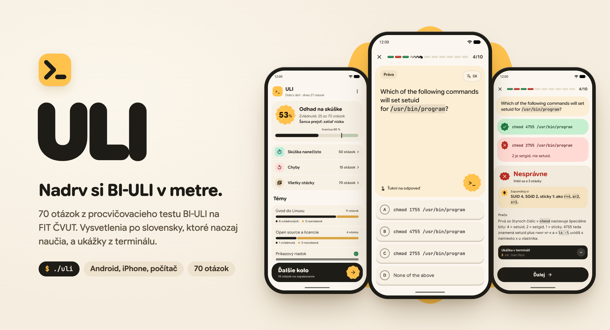

<p align="center">
  
</p>

<p align="center">
  <a href="https://github.com/teoobarca/bi-uli/releases/latest/download/ULI.apk"><b>⬇ Android: stiahnuť ULI.apk</b></a>
  &nbsp;·&nbsp; <a href="https://uli.hamper.dev/"><b>iPhone a počítač: otvoriť v prehliadači</b></a>
  &nbsp;·&nbsp; offline &nbsp;·&nbsp; zadarmo
</p>

**ULI** je appka pre Android, iPhone aj počítač na precvičenie zápočtového testu **BI-ULI (Úvod do Linuxu)** na FIT
ČVUT. Obsahuje všetkých 70 otázok z procvičovacieho testu, ktorý študenti zdieľajú na fit-wiki. Pri každej otázke sa
dozvieš, prečo je odpoveď správna a prečo tá tvoja nebola. Kolo má 10 otázok, takže ho stihneš cestou v metre.

Celá appka vznikla z jedného promptu v [Claude Code](https://claude.com/claude-code) a [T3 Code](https://t3.codes).

## Inštalácia (2 minúty)

**Android** (13 a novší)

1. V mobile otvor [**ULI.apk**](https://github.com/teoobarca/bi-uli/releases/latest/download/ULI.apk) a stiahni ho.
2. Ťukni na stiahnutý súbor. Android sa spýta, či môže prehliadač inštalovať aplikácie, daj **Povoliť**.
3. **Inštalovať**. Hotovo, ďalej appka nepotrebuje internet.

Novšiu verziu nainštaluješ rovnako, cez tú starú. Tvoj postup ostane.

**iPhone** (iOS 18.2 a novší)

1. V Safari otvor [uli.hamper.dev](https://uli.hamper.dev/).
2. Ťukni na **Zdieľať** a potom na **Pridať na plochu**. Sprav to ešte pred učením: appka na ploche začína od nuly
   a v Safari sa postup po 7 dňoch bez návštevy zmaže.
3. Otvor ULI z plochy. Po prvom načítaní (asi 5 MB) funguje aj bez internetu.

**Počítač:** stačí [otvoriť tú istú stránku](https://uli.hamper.dev/) v aktuálnom prehliadači.

<table>
<tr>
<td width="300"></td>
<td>

### Čo vie

- **Kolá po 10 otázkach.** Na odpoveď stačí jeden ťuk, možnosti máš dole pod palcom.
- **Spätná väzba, ktorá učí.** Dozvieš sa, prečo je odpoveď správna, prečo je tvoja voľba zlá, dostaneš pomôcku
  na zapamätanie a ukážku z terminálu.
- **Chyby sa vracajú.** Otázka, ktorú pokazíš, príde znova o 3 otázky. Potom o pár minút, o pár hodín a o pár dní,
  kým ju nevieš naisto (Leitnerove boxy).
- **Skúška nanečisto.** 50 náhodných otázok bez nápovedy a so stopkami, výsledok v bodoch ako na ostrom teste.
- **Úprimný odhad.** Domov ukáže, koľko by si mal na skúške a akú máš šancu prejsť. Po zlej odpovedi odhad nikdy
  nestúpne.
- **Otázky ostávajú po anglicky**, presne ako na teste. Tlačidlo SK ukáže slovenský preklad.

</td>
</tr>
</table>

## Zápočtový test v kocke

| | |
|---|---|
| Čo to je | test **Final Comprehensive Exam (Modules 2-18)** v NetAcad kurze „ULI 2026“, píše sa v učebni FIT |
| Otázky | 50 otázok po anglicky, náhodne zo všetkých kapitol |
| Body | 1,6 b za otázku, spolu 80 b |
| Na zápočet | **aspoň 64 b** (80 %), t. j. najviac 10 chýb |
| Pokusy | 2 |
| Pomôcky | žiadne, ani papier a pero, so sebou študentský preukaz |
| Výsledok | hneď po odovzdaní |

Zdroje: [courses BI-ULI](https://courses.fit.cvut.cz/BI-ULI/classification/index.html) (body, pokusy, pomôcky),
NetAcad kurz „ULI 2026“ (názov testu, 80 b, 2 pokusy), [fit-wiki BI-ULI](https://fit-wiki.cz/%C5%A1kola/p%C5%99edm%C4%9Bty/bi-uli)
(50 otázok).

**Sú to práve týchto 70 otázok?** Oficiálne courses hovorí len „náhodně vybrané otázky ze všech kapitol“. Študenti
na fit-wiki však od roku 2019 zhodne píšu, že ostrý test je výber 50 otázok z poolu 70 a že procvičovací test
„obsahuje vše co může být v testu“. Tých 70 otázok zároveň pokrýva všetky kapitoly. Istotu na 100 % ti nedá nikto,
ale všetko nasvedčuje tomu, že áno.

**Prihlás sa vopred.** Na netacad.com si skontroluj, že sa dostaneš do kurzu „ULI 2026“. Podľa Discordu ľudia
často zistia až pred testom, že nemajú heslo.

## Pozor na týchto 9 otázok

Test sa hodnotí podľa kľúča Cisco/NDG, ktorý sa miestami nezhoduje so skutočným Linuxom. Appka učí odpoveď podľa
kľúča, lebo za ňu dostaneš body, a pri týchto otázkach ťa na rozdiel upozorní.

| # | Kľúč chce | V praxi |
|---|---|---|
| 6 | Windows nemá „Linux compatibility mode“ | Windows 10/11 má WSL |
| 7 | Interpretované jazyky „majú viac funkcií“ | Všeobecne to neplatí |
| 33 | `tar -tzf foo.tar.gz` | GNU tar zvládne aj `tar -tf` (kompresiu rozpozná sám) |
| 41 | `test $USERS -eq 5` | Pri hodnote 5 prejde aj `test $USERS = 5` (porovná reťazce) |
| 44 | GPT: `sgdisk`, `gdisk`, `cgdisk` | Aj novší `sfdisk` už vie GPT |
| 45 | `ps` ukáže len procesy aktuálneho shellu: True | Presnejšie: procesy s tvojím EUID na tom istom termináli |
| 51 | `service network restart` „vypne rozhrania, znova načíta konfiguráciu…“ | Aj „zastaví a znova spustí“ je pravda |
| 54 | Tradičný UNIX: 16 skupín | Závisí od verzie (V7 mal 1 aktívnu, BSD 16) |
| 59 | `groupmod` nepridáva používateľov: False | shadow-utils 4.11+ má `groupmod -a -U` |

## Obrazovky

<p align="center"></p>

<details>
<summary>Tmavý režim</summary>
<p align="center"></p>
</details>

## Časté otázky

**Potrebuje internet?** Nie. Android appka nemá ani povolenie na internet, webová ho potrebuje len na prvé načítanie.
Tvoj postup ostáva len v tvojom zariadení a medzi zariadeniami sa neprenáša.

**Android hlási „neznámy zdroj“ alebo Play Protect.** Je to bežné pri appkách mimo Google Play. Celý zdrojový kód je
tu v repe, APK si môžeš zostaviť aj sám (pozri nižšie).

**Našiel som chybu v otázke alebo vo vysvetlení.** Založ [issue](https://github.com/teoobarca/bi-uli/issues) alebo
uprav [`content/questions.json`](content/questions.json) a pošli pull request. Každá otázka je jeden objekt
s textom, možnosťami, vysvetlením a ukážkou.

<details>
<summary><b>Pre vývojárov</b></summary>

Kotlin, Compose Multiplatform, Material 3: jeden kód pre Android aj web (Kotlin/Wasm). Žiadny server ani analytika.

- `content/questions.json`: 70 otázok, zdroj pravdy. `python3 content/check.py` ho skontroluje.
- `shared/src/commonMain/kotlin/dev/hamper/uli/`: celá appka. `engine/` je učenie (Leitnerove boxy, kolá, skúška, odhad), pokryté
  unit testami.
- `app/` je obal pre Android, `shared/src/wasmJsMain/` obal pre prehliadač.
- Postup je v `progress.json`, rozrobené kolo alebo skúška v `session.json` (na webe v `localStorage`). Poškodené dáta
  sa nezmažú, appka ich odloží bokom.

```sh
scripts/gate.sh                  # testy + debug build + kontrola obsahu
scripts/web.sh                   # webová verzia do build/web/
uvx --with playwright==1.64.0 python scripts/web-check.py   # prejde ju v iPhone, Android aj počítačovom prehliadači
scripts/web-publish.sh           # zverejní ju na GitHub Pages (vetva gh-pages)
scripts/capture.sh <dir>         # zábery všetkých obrazoviek v oboch témach (beží na emulátore)
./gradlew :app:assembleRelease   # potrebuje podpisový kľúč v ~/.uli/android-signing.properties
```

Potrebuješ JDK 21 a Android SDK (compileSdk 37). Debug build (`./gradlew :app:installDebug`) kľúč nepotrebuje.

</details>

## Licencia

Neoficiálny študentský projekt, nemá nič spoločné s ČVUT, FIT ani Cisco. Texty otázok a odpovedí patria
Cisco Networking Academy / NDG (kurz Linux Essentials) a pochádzajú z procvičovacieho testu, ktorý študenti
zdieľajú na fit-wiki. Vysvetlenia, preklady a kód sú pod licenciou [MIT](LICENSE). Fonty Google Sans Flex
a JetBrains Mono sú pod licenciou [OFL](licenses/).
